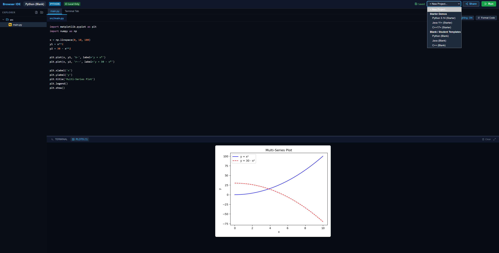

# WhyDE (Browser IDE)

**WhyDE** is a fast, completely serverless in-browser coding environment and Progressive Web App (PWA). It runs **Python**, **C++**, and **Java** code 100% locally inside the web browser using WebAssembly.

No backend servers to set up, no Docker containers to maintain, no data being sent to a third party.


**Launch in your browser:** [https://maltob.github.io/whyde](https://maltob.github.io/whyde)


## What Does It Look Like?
WhyDE provides a clean, familiar coding workspace:
- **Left Panel**: Multi-file explorer with folder hierarchies and drag-and-drop file upload.
- **Center**: Monaco code editor with syntax color, standard library autocomplete.
- **Right / Bottom Panel**: Interactive execution terminal supporting keyboard input, execution logs, and plotting tabs.



## How Do I Use It?

### 1. As a Student or tester
1. **Choose a language**: Select Python, C++, or Java from the top navigation bar.
2. **Write or drop in your files**: Click `+ New File`, or drag and drop code files from your desktop straight into the file explorer.
3. **Click Run**: Watch your code compile and execute instantly with non-blocking WebAssembly. If your code asks for input (e.g. `name = input("What is your name? ")`), simply type into the integrated terminal.
4. **Work offline**: WhyDE installs as a PWA and caches all files locally in your browser's IndexedDB. Your work is saved automatically as you type.

### 2. As an Instructor or Course Author
WhyDE was built to make sharing assignments effortless:
1. **Prepare your assignment starter**: Open WhyDE, add your starter code, templates, and reference files. You can drag and drop files into the explorer from your PC
2. **Click Share**: In the top bar, click the **Share** button.
3. **Configure student options**: Choose whether to hide project creation, disable autocomplete (for exam mode), or open a specific starter file on load.
4. **Copy & Share the Link**: Click **Copy Link**. When students open this link, WhyDE instantly opens your exact assignment workspace in their browser without overwriting your original.
5. **Embed in Canvas, Blackboard, or LMS**: Paste the URL into any `<iframe>` in your course portal. 


## Instructor Guide & URL Parameters

Configure any student session by appending hash parameters to your URL (e.g. `https://maltob.github.io/whyde/#lang=python&blank=true`):

| URL Parameter | Options | Description | Common Use Case |
| :--- | :--- | :--- | :--- |
| `lang` | `python`, `cpp`, `java` | Pre-selects the project language on launch. | Linking directly to a Python or Java lab. |
| `file` | Path (e.g. `src/main.cpp`) | Sets which file is open and focused in the editor. | Directing attention to the starter file. |
| `blank` | `true`, `1` | Opens with an empty file instead of template code. | Scratchpads, quizzes, and homework. |
| `hideNewProject`| `true`, `1` | Hides the "+ New Project" button in the navigation bar. | Keeping students focused on the active lab. |
| `highlight` | `on`, `off` | Toggles syntax highlighting on or off. | Testing raw syntax knowledge in exams. |
| `codeSuggest` | `1`, `0` | Enables or disables code autocompletion. | Exam mode or testing syntax recall. |

### Ready-to-Use Instructor Examples
- **Python Exam Mode** (No autocomplete, no syntax highlighting, project creation hidden):  
  `https://maltob.github.io/whyde/#lang=python&highlight=off&codeSuggest=0&hideNewProject=true`
- **C++ Starter Lab**:  
  `https://maltob.github.io/whyde/#lang=cpp&file=src/main.cpp`
- **Java Blank Scratchpad**:  
  `https://maltob.github.io/whyde/#lang=java&blank=true`

### Embedding in an LMS (Canvas, Moodle, Blackboard)
```html
<iframe
  src="https://maltob.github.io/whyde/#lang=python&hideNewProject=true"
  width="100%"
  height="700px"
  style="border: 1px solid #e2e8f0; border-radius: 8px;"
  allow="clipboard-read; clipboard-write">
</iframe>
```

---

## Local Development & Contribution

### Prerequisites
- Node.js >= 20
- pnpm >= 9

### Quick Start
```bash
# Clone the repository
git clone https://github.com/maltob/whyde.git
cd whyde

# Install dependencies
pnpm install

# Run Vite development server
pnpm --filter @ide/web dev
```

### Building for Production
```bash
# Download offline wheels, compile packages and web application
pnpm download:wheels
pnpm build
```


## License

Licensed under the [Apache License, Version 2.0](LICENSE).
